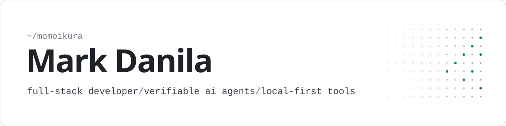
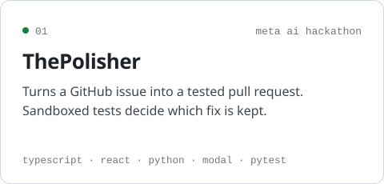
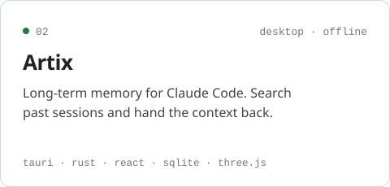
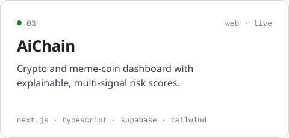
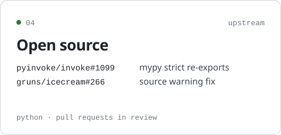

<picture>
  <source media="(prefers-color-scheme: dark)" srcset="assets/header-dark.svg">
  
</picture>

  <samp>
    <a href="https://github.com/momoikura/The-Polisher">the-polisher</a> ·
    <a href="https://github.com/momoikura/Artix">artix</a> ·
    <a href="https://github.com/momoikura/AiChain">aichain</a> ·
    <a href="https://thepolisher.pages.dev">live demo</a> ·
    <a href="mailto:markdanila12@gmail.com">email</a>
  </samp>

 

<a href="https://github.com/momoikura/The-Polisher"><picture><source media="(prefers-color-scheme: dark)" srcset="assets/polisher-dark.svg"></picture></a> <a href="https://github.com/momoikura/Artix"><picture><source media="(prefers-color-scheme: dark)" srcset="assets/artix-dark.svg"></picture></a>
<a href="https://github.com/momoikura/AiChain"><picture><source media="(prefers-color-scheme: dark)" srcset="assets/aichain-dark.svg"></picture></a> <a href="https://github.com/search?q=is%3Apr+author%3Amomoikura+-user%3Amomoikura&type=pullrequests"><picture><source media="(prefers-color-scheme: dark)" srcset="assets/oss-dark.svg"></picture></a>

 

  <samp>typescript · python · rust · react · next.js · tauri · supabase · postgres · modal</samp>

